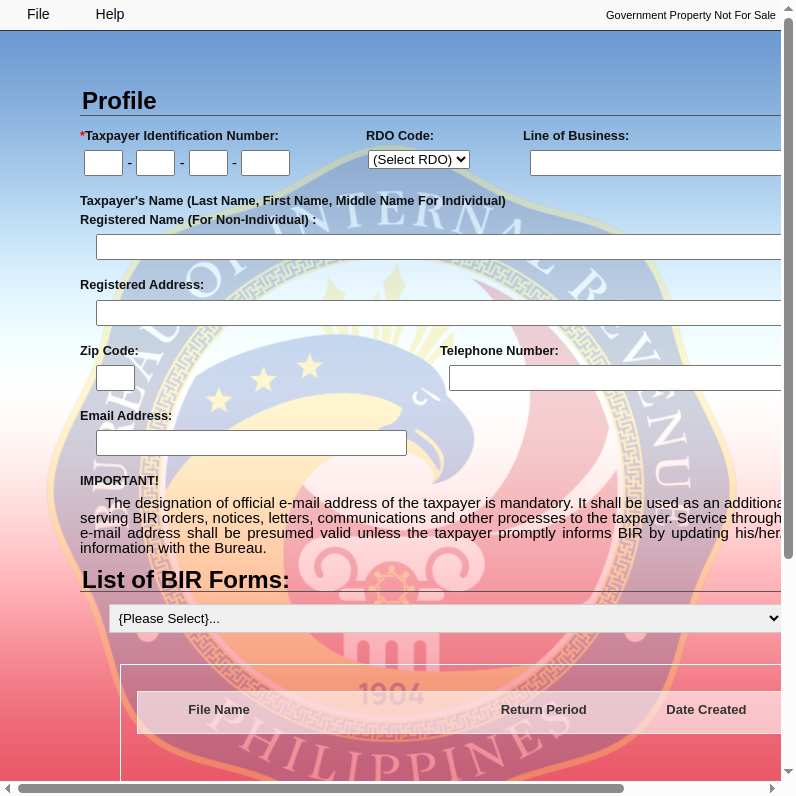
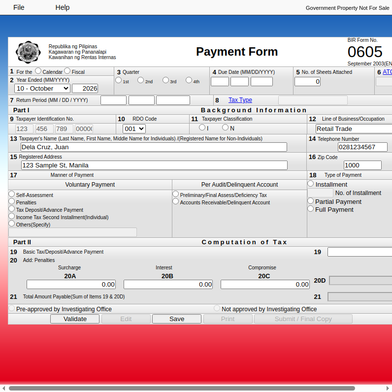
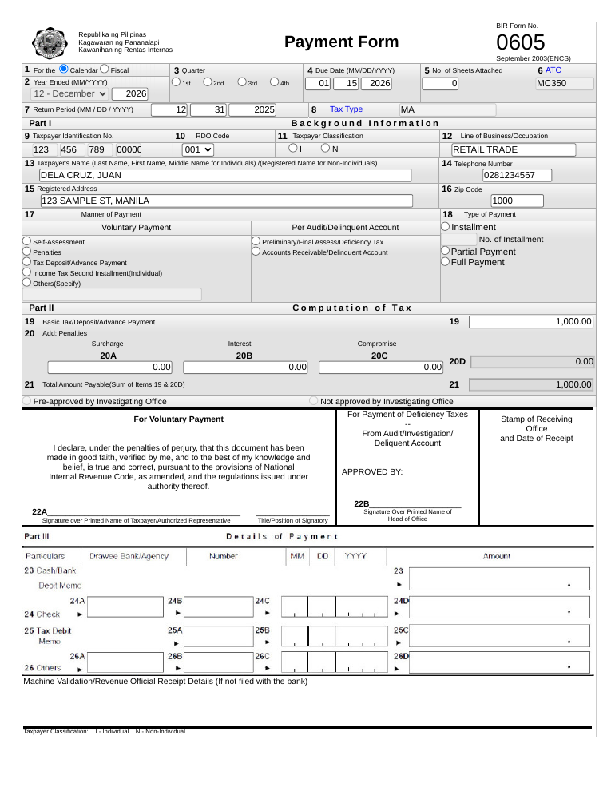

# Offline eBIRForms — native Linux port

A native Linux re-host of the Philippine BIR **Offline eBIRForms Package v7.9.6.1**
(`ebirforms_package_installer_v7.9.6.1.exe`).

It runs the **original BIR form assets, unmodified**, in a native Chromium
(QtWebEngine) window and supplies the Windows automation objects they expect.
There is **no Wine, no `mshta`/IE, and no Microsoft binary** at runtime.



---

## 1. What the Windows package actually is (reverse-engineering summary)

Recovered with `innoextract`, `pefile`, `objdump` and REA (`rea analyze`,
`rea decompile`):

| Layer | Finding |
| --- | --- |
| Installer | Inno Setup **5.5.7** (so `7z` fails on it; `innoextract` works) |
| Payload | `BIRForms.exe` 55 MB, `cFTPSend.exe`, `Encrypt.exe`, `chkt.exe`, `ebfSFTP.exe` (.NET 4.7.2), `WinSCP.exe`, `WinSCPnet.dll`, `xml/*.xml` data lookups |
| `BIRForms.exe` | **Not** .NET. Native C++ (MSVC 14.24), only ~176 KB of code — a thin **Internet Explorer host window** |
| Where the app is | 58 MB of `RT_HTML` PE resources: **465 blobs → 464 files** (147 `.hta` forms, jQuery, CSS, images, `js/eBIRTools.vbs`) |
| Obfuscation | Each blob is stored **bitwise complement** (`byte ^ 0xFF`). `10 44 40 C3` → `EF BB BF 3C` = UTF-8 BOM + `<` |
| Manifest | Blob id 129 is a UTF-16LE `{GUID}\|name\|name\|…` table; the remaining blobs map to names in ascending id order. Six `.gitkeep` entries have no resource — ignoring them is what makes the mapping line up |
| Form logic | JScript + jQuery 1.7 (in-Chromium compatible). Only `js/eBIRTools.vbs` (281 lines) is real VBScript, and it is a thin wrapper that shells out to `chkt.exe`, `Encrypt.exe`, `ebfSFTP.exe` |
| Native surface used by the scripts | `Scripting.FileSystemObject` (1312 uses), `XMLHttpRequest` (88 files), `Microsoft.XMLDOM` (8), `WScript.Shell` (7), `Shell.Application` (4), `window.external`, a few IE-isms |

## 2. How the port works

```
QtWebEngine window (Chromium)                     Python host (same process tree)
┌───────────────────────────────┐   sync XHR    ┌────────────────────────────────┐
│ original BIR .hta + jQuery    │ ────────────► │ 127.0.0.1:<ephemeral>          │
│ compat.js  (ActiveXObject,    │  /__host/…    │  • static assets (sandboxed)   │
│  FSO, XMLDOM, WScript.Shell,  │ ◄──────────── │  • fs read/write/list/copy/…   │
│  HTA:APPLICATION, IE shims)   │               │  • native print (PDF/printer)  │
│ ebirtools.js (VBScript API)   │               │  • file dialogs, zip, env      │
└───────────────────────────────┘               └────────────────────────────────┘
```

* **Why a local HTTP server:** the BIR scripts use *synchronous*
  `FileSystemObject` calls. A blocking `XMLHttpRequest` to loopback is the only
  way to give a browser engine synchronous file I/O; the renderer lives in its
  own process, so the Qt UI thread stays free (it can even run a dialog for that
  same request). Serving over `http://127.0.0.1` also keeps relative
  `<script src>`/XHR same-origin, like `mshta` did.
* **`compat.js`** is injected at document creation into the main world and
  implements `ActiveXObject` (`Scripting.FileSystemObject`, `Scripting.Dictionary`,
  `Microsoft.XMLDOM`/`MSXML2.DOMDocument`, `Microsoft.XMLHTTP`, `WScript.Shell`,
  `WScript.Network`, `Shell.Application`), `CreateObject`/`GetObject`,
  `Enumerator`, `window.external`, `window.print`, `execCommand`,
  `attachEvent`, `HTA:APPLICATION` attribute→property mapping, and
  **case-insensitive property access** — COM was case-insensitive, JavaScript is
  not, and the shell reads `FSo.item().name`.
* **`ebirtools.js`** is served at the URL of `js/eBIRTools.vbs` and exposes the
  same global functions. The host also rewrites
  `<script language="VBScript">` to `<script type="text/javascript">` in flight
  (Chromium refuses unknown script types); **no asset on disk is modified**.
* **Paths** are resolved inside one writable application directory. Windows-style
  paths (`C:\eBIRForms\xml\atcCodes.xml`, `profile\123…xml`) are mapped onto it;
  nothing can escape it.

## 3. Requirements

* `python3` (3.9+) with **PySide6** and QtWebEngine: `python3 -m pip install PySide6`
* To re-extract assets from an installer (once, and again for future versions):
  * `innoextract` — `dnf install innoextract` (or `apt install innoextract`)
  * `pefile` — `python3 -m pip install pefile`

## 4. Run it

```sh
# 1. recover the asset tree from the official installer (once)
python3 tools/extract_assets.py            # picks up the .zip/.exe in this folder

# 2. start the app
./run.sh
```

`tools/extract_assets.py` accepts an explicit installer path
(`python3 tools/extract_assets.py ~/Downloads/Offline_eBIRForms_Package_v7.9.6.1_setup.zip`)
and writes `assets/app` plus `assets/recovered.json` (provenance: resource ids,
sizes, files overlaid from the installer).

### Install as a desktop application

```sh
mkdir -p ~/.local/share/applications ~/.local/share/icons/hicolor/256x256/apps
cp packaging/ebirforms-native.png ~/.local/share/icons/hicolor/256x256/apps/
sed "s#/home/admin/Desktop/Workspace/ebirforms#$PWD#" packaging/ebirforms-native.desktop \
    > ~/.local/share/applications/ebirforms-native.desktop
update-desktop-database ~/.local/share/applications 2>/dev/null || true
```

### Where your data lives

| What | Where |
| --- | --- |
| Application tree, profiles, saved returns (`profile/`, `savefile/`, `logfile/`) | `$XDG_DATA_HOME/ebirforms-native/app` — falling back to `~/.local/share`, `./.data`, or `/tmp/ebirforms-native-<uid>` when the home mount is read-only |
| Web profile (cookies/localStorage) | `$XDG_DATA_HOME/ebirforms-native/web` |
| Host log (page console, file I/O, warnings) | `$XDG_STATE_HOME/ebirforms-native/logs/host.log` |

Program files are re-seeded from `assets/app` when the assets change; taxpayer
data (`profile/`, `savefile/`, `logfile/`) is **never** deleted by an upgrade.

## 5. What works

Verified on this machine (offscreen QtWebEngine, screenshots + PDF evidence):

* Shell loads: profile entry, File/Help menus, BIR form list, saved-return table.
* Profile save → `profile/<TIN>.xml` through the `FileSystemObject` shim; profile
  is then bound into the form's Background Information (TIN, RDO, name, address,
  telephone, zip, line of business).
* Form 0605: open → fill → **autocompute** (`21 = 1,000.00` from item 19) →
  form's own validation gates → **Save** to `savefile/<TIN>-0605-<period>.xml`
  → reload that return and get the amounts back → **Print** to a real PDF/return.
* All 147 form documents and 4 lookups (`xml/*.xml`) are served from the
  recovered tree, so the same machinery applies to the other forms.

| Profile bound into Form 0605 | Printed return (native PDF) |
| --- | --- |
|  |  |

## 6. Known gaps

| Gap | Detail |
| --- | --- |
| **TIN check digit** | Windows calls `chkt.exe` and uses its exit status. Its weighted check-digit routine resolves into Free Pascal runtime helpers; the reconstruction is not yet bit-exact, so the port **validates structure (9 digits) and logs that the check digit is not enforced** instead of rejecting a taxpayer's real TIN. Wire it up in `native/ebirforms_host/ebirtools.js` (`ValidateTinWChkDgt`). |
| **Submission (upload)** | "Submit / Final Copy" needs `Encrypt.exe` (AES packaging) and `ebfSFTP.exe`/WinSCP (SFTP). Not ported: the host returns a clear failure and logs it, rather than pretending to succeed. Offline filing, printing and saving are unaffected. |
| **Rendering fidelity** | IE9-era CSS rendered by Chromium: layouts verified for the shell, form 0605, help pages; other forms may show small spacing differences. |
| **Print** | `window.print()` renders the return to PDF and sends it to `lp`, or opens it in the default viewer. Override with `EBIR_PRINT_CMD` / `EBIR_PRINT_AS_PDF=1`. |
| **Cross-origin XHR** | The scripts call `birgovph.com` for version checks; the app runs with web security disabled (the trust level an HTA had under `mshta`). Offline those calls simply fail, as intended. |

## 7. Layout

```
tools/extract_assets.py     installer → assets/app (Inno + PE resource recovery)
assets/app/                 recovered runtime tree (generated, 464 files)
assets/recovered.json       provenance of the last extraction
native/run.py               entry point / test harness
native/ebirforms_host/
  paths.py                  writable-path probing, seeding, upgrade overlay
  store.py                  sandboxed file store, FSO text encodings
  server.py                 static server + synchronous host RPC
  compat.js                 Windows automation object shims (injected)
  ebirtools.js              native replacement for js/eBIRTools.vbs
  ui.py                     Qt windows/pages, popups, dialogs, print
run.sh                      launcher
packaging/                  .desktop entry + icon
```

## 8. Reproducing the verification

The entry point doubles as a headless harness (offscreen Chromium, screenshots,
PDF, console dump):

```sh
# shell render
QT_QPA_PLATFORM=offscreen python3 native/run.py --headless --wait 8 \
  --screenshot /tmp/shell.png

# form render + native print
QT_QPA_PLATFORM=offscreen python3 native/run.py \
  --page 'forms/BIR-Form0605.hta?xmlBGInfoFileName=profile/12345678900000.xml' \
  --headless --wait 12 --screenshot /tmp/form0605.png --pdf /tmp/form0605.pdf

# drive the UI (any JS) before capturing
QT_QPA_PLATFORM=offscreen EBIR_AUTO_DISMISS=1 python3 native/run.py --headless \
  --wait 16 --eval "document.getElementById('frm0605:txtTax19').value='1000.00'; \
                    document.getElementById('frm0605:cmdValidate').click()" \
  --screenshot /tmp/filled.png
```

Useful environment switches: `EBIR_WORKDIR`, `EBIR_ASSETS`, `EBIR_CHROMIUM_FLAGS`,
`EBIR_VERBOSE=1`, `EBIR_ECHO_JS=1`, `EBIR_AUTO_DISMISS=1` (headless),
`EBIR_PRINT_AS_PDF=1`, `EBIR_PRINT_CMD`.

## 9. Updating to a newer eBIRForms release

1. Put the new installer (or its `.zip`) in this folder.
2. `python3 tools/extract_assets.py`
3. Start the app — the new program tree is overlaid into the application
   directory, existing profiles/returns are kept.

## 10. Legal note

The BIR form content belongs to the Bureau of Internal Revenue and is not
included in this repository: it is extracted locally from the official
installer you already have. This port only supplies the runtime that the
Windows package used to get from `mshta.exe`/IE.
